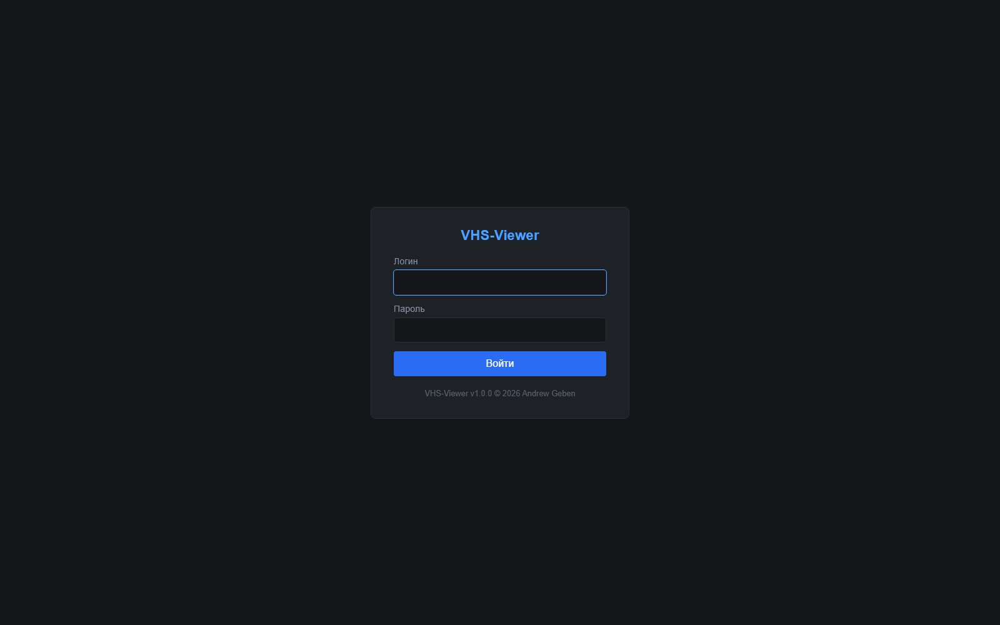
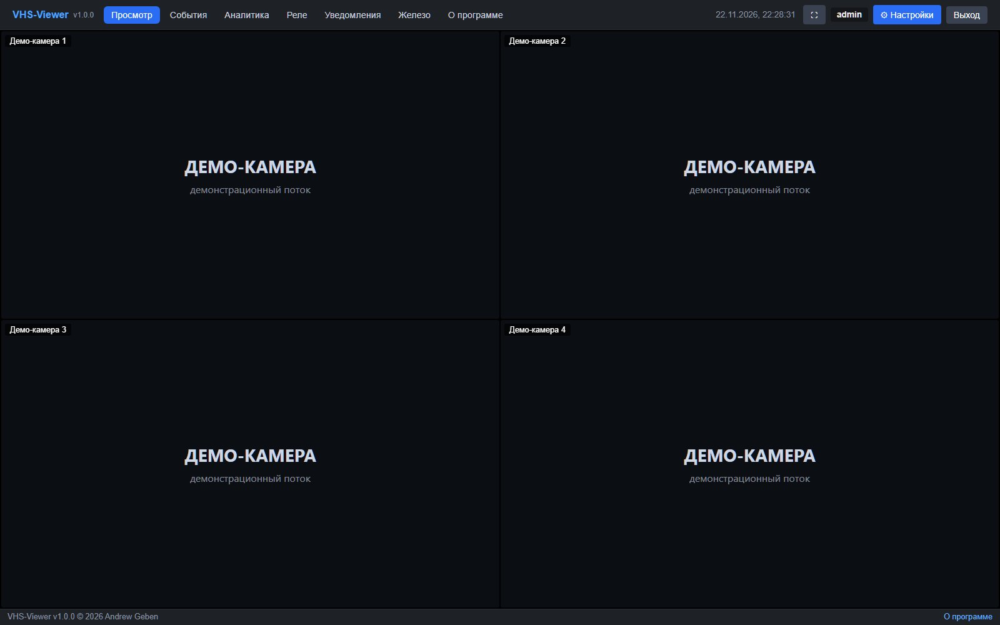
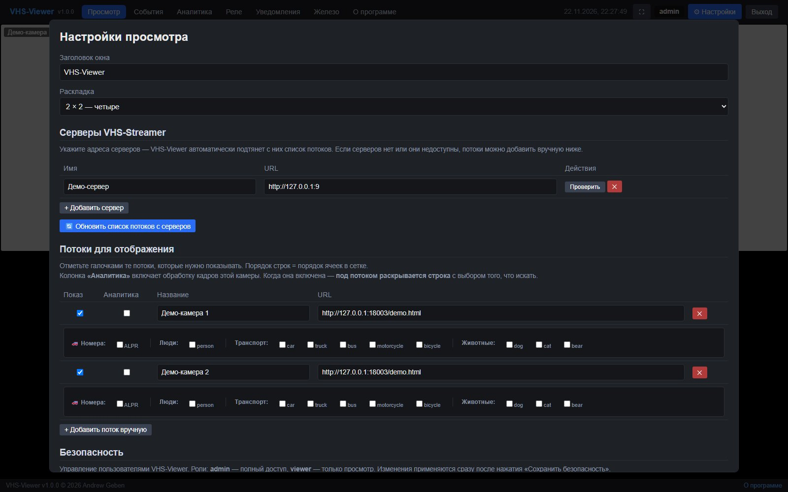
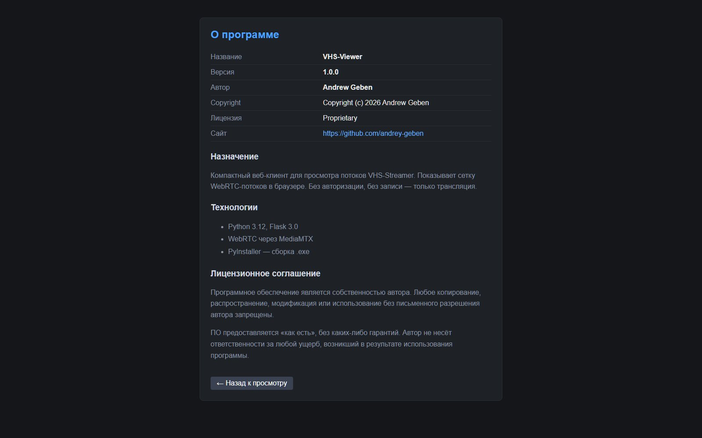

# VHS-Viewer

[](https://github.com/andrey-geben/VHS-Viewer/actions/workflows/ci.yml)
[](LICENSE)

Компактный веб-клиент для просмотра потоков **VHS-Streamer** в браузере.

Показывает сетку WebRTC-трансляций с одного или нескольких серверов
VHS-Streamer. Автоматически подтягивает список потоков через API, позволяет
включать/выключать нужные камеры галочками, переключать раскладки и управлять
PTZ. Работает как шлюз между Streamer и **VHS-Security**.

Первый запуск — мастер настройки (адрес VHS-Streamer, администратор и ключ
интеграции). Клиент не пишет в архив — только трансляция и аналитика.

---


## Скриншоты

| Вход | Сетка камер |
|---|---|
|  |  |

| Настройки просмотра | О программе |
|---|---|
|  |  |

## Возможности

- **Сетка видеопотоков** — компактная мозаика, от 1 до 16 камер.
- **Несколько серверов** — несколько VHS-Streamer одновременно, у каждого
  свой `api_key`; потоки объединяются в один список.
- **Автоматическая загрузка** — опрос Streamer через
  `/api/integration/streams` с ключом; публичный `/api/public/streams`
  используется как резерв.
- **Без дублей** — повторная проверка Streamer обновляет существующие
  потоки по UID/пути и добавляет только новые.
- **Ручное добавление потоков** — URL можно ввести вручную.
- **Раскладки** — 1×1, 2×2, 3×1, 3×3, 4×4, авто (по размеру окна).
- **PTZ** — панель на камерах с `has_ptz`: движение, зум, домой, стоп,
  инверсия осей. Команды проксируются в Streamer.
- **Выбор потоков** — галочками отметить, что показывать.
- **Часы и монитор** — время, CPU/RAM/диски/сеть в футере.
- **Интеграция с Security** — `/api/integration/state`, `/events`,
  `/ptz/*` и снапшоты по внутреннему ключу.
- **Сохранение настроек** — в `viewer_config.yaml` рядом с приложением.

---

## Архитектура

```text
┌─────────────────────────────────────────────────────┐
│  VHS-Streamer (:8100)                               │
│  ├─ камеры, архив, транскодирование, PTZ/ONVIF      │
│  ├─ MediaMTX :8554 (RTSP) + :8889 (WebRTC)          │
│  └─ /api/integration/* + /api/ptz/capabilities      │
└─────────────────────────────────────────────────────┘
                     │ X-VHS-Key
                     ▼
┌─────────────────────────────────────────────────────┐
│  VHS-Viewer (:8200)                                 │
│  ├─ список серверов и потоков                       │
│  ├─ WHEP-плеер, аналитика, PTZ-прокси               │
│  └─ /api/integration/* ← ключ для Security          │
└─────────────────────────────────────────────────────┘
                     │ X-VHS-Key
                     ▼
┌─────────────────────────────────────────────────────┐
│  VHS-Security (:8300)                               │
│  └─ карта, зоны, тревоги, мозаика                   │
└─────────────────────────────────────────────────────┘
```

**Ключевая идея.** Viewer не работает с ONVIF напрямую: он получает потоки
и PTZ-возможности из Streamer, а Security получает всё необходимое из Viewer.
Видео идёт из MediaMTX в браузер через WebRTC/WHEP.

---

## Требования

- **Python 3.12+** (только для установки из исходников).
- **Windows 10/11**, **Linux**, или **macOS**.
- **VHS-Streamer** запущен и доступен по сети — источник потоков.

---

## Быстрый старт

### Windows

```powershell
git clone https://github.com/andrey-geben/VHS-Viewer.git
cd VHS-Viewer

python -m venv .venv
.\.venv\Scripts\Activate.ps1

pip install -r requirements.txt
python viewer.py
```

Откроется браузер на `http://127.0.0.1:8200`.

### Linux

```bash
git clone https://github.com/andrey-geben/VHS-Viewer.git
cd VHS-Viewer

python3 -m venv .venv
source .venv/bin/activate

pip install -r requirements.txt
python viewer.py
```

### Развёртывание из `.exe`

1. Скачайте готовый архив `VHS-Viewer-win-x64.zip` со страницы релизов.
2. Распакуйте в любую папку.
3. Запустите `VHS-Viewer.exe`.
4. Браузер откроется автоматически на `http://127.0.0.1:8200`.

Python устанавливать не нужно.

---

## Настройка

### 1. Открыть настройки

Кнопка **⚙ Настройки** в правом верхнем углу.

### 2. Добавить сервер

Раздел **«Серверы VHS-Streamer»**:

| Поле | Значение | Пример |
|---|---|---|
| Имя | Произвольное | `Главный` |
| URL | Адрес VHS-Streamer | `http://192.168.1.101:8100` |
| Ключ | `security.api_token` из Streamer | `X-VHS-Key` |

Нажмите **«Проверить»** — появится статус:

```
✓ VHS-Streamer (2 потоков)
```

### 3. Загрузить потоки

Кнопка **«🔄 Обновить список потоков с серверов»** — VHS-Viewer опросит
все серверы и добавит **только новые** потоки. Существующие строки
обновляются по UID/пути и не создают дублей, даже если WebRTC-токен в URL
изменился.

Новые потоки добавляются **не отмеченными**.

### 4. Выбрать, что показывать

Раздел **«Потоки для отображения»**:

| Колонка | Что означает |
|---|---|
| **Показ** | Галочка — показывать этот поток |
| **Название** | Имя камеры (можно править) |
| **URL** | WebRTC-адрес потока |
| **✕** | Удалить строку |

### 5. Настроить раскладку

Выпадающий список **«Раскладка»**:

| Значение | Что даёт |
|---|---|
| `1 × 1` | Одна камера на весь экран |
| `2 × 2` | Четыре камеры |
| `3 × 1` | Три камеры в один ряд |
| `3 × 3` | Девять камер |
| `4 × 4` | Шестнадцать камер |
| `Авто` | По размеру окна |

### 6. Сохранить

Кнопка **«Сохранить»** — настройки записываются в `viewer_config.yaml`.

---

## Формат `viewer_config.yaml`

```yaml
title: VHS-Viewer
layout: 3x1
servers:
  - name: Главный
    url: http://192.168.1.101:8100
    api_key: <security.api_token из Streamer>
  - name: Резервный
    url: http://192.168.1.102:8100
    api_key: <ключ второго Streamer>
streams:
  - name: Вход
    url: http://192.168.1.101:8889/analog_1_s1/
    enabled: true
  - name: Двор
    url: http://192.168.1.101:8889/analog_1_s2/
    enabled: true
  - name: Склад
    url: http://192.168.1.101:8889/analog_1_s3/
    enabled: false
integration:
  ingest_key: <ключ Viewer для Security>
```

**Что здесь что:**
- `title` — заголовок окна.
- `layout` — раскладка (1x1, 2x2, 3x1, 3x3, 4x4, auto).
- `servers` — Streamer-серверы; `api_key` нужен для интеграции и PTZ.
- `streams` — список потоков с флагом `enabled`.
- `integration.ingest_key` — ключ, которым Security обращается к Viewer.

**Важно:** `streams` и `servers` — независимые списки. Даже если сервер
недоступен, потоки продолжат работать — они хранят готовые WebRTC-URL.

---

## Использование

### Полноэкранный режим

Кнопка **⛶** в шапке — разворачивает на весь экран.

Выход — **Esc** или повторное нажатие **⛶**.

### Часы

В шапке показывается текущее время сервера. Полезно на посту охраны.

### Обновление потоков

Если в VHS-Streamer добавили новую камеру:

1. Открыть настройки VHS-Viewer.
2. Нажать **🔄 Обновить список потоков**.
3. Отметить новый поток галочкой.
4. Сохранить.

Старые потоки не трогаются — обновление только добавляет новое.

### Мультисерверный режим

VHS-Viewer может работать с несколькими серверами VHS-Streamer
одновременно. Добавьте в настройках каждый сервер, нажмите
**🔄 Обновить** — увидите единый список потоков со всех серверов.

Полезно в больших системах: один сервер на первый этаж, второй —
на второй, а оператор видит всё вместе.

---

## API

VHS-Viewer тоже имеет HTTP API для внешних интеграций:

| Метод | Путь | Описание |
|---|---|---|
| GET | `/` | Главная страница с сеткой |
| GET | `/about` | Информация о программе |
| GET | `/api/config` | Текущий конфиг |
| POST | `/api/config` | Сохранить конфиг |
| POST | `/api/servers/test` | Проверить сервер VHS-Streamer |
| POST | `/api/servers/refresh` | Обновить потоки со всех серверов |
| GET | `/api/status` | Версия и автор |
| GET | `/api/ptz/capabilities` | PTZ-возможности камер |
| POST | `/api/ptz/<camera_id>/<action>` | PTZ через Viewer |
| GET | `/api/integration/state` | Состояние для Security (ключ) |
| GET | `/api/integration/events` | События для Security (ключ) |
| GET | `/api/integration/ptz/capabilities` | PTZ для Security (ключ) |
| POST | `/api/integration/ptz/<id>/<action>` | PTZ-команда из Security (ключ) |

**Пример — проверить сервер VHS-Streamer:**

```bash
curl -X POST http://localhost:8200/api/servers/test \
     -H "Content-Type: application/json" \
     -d '{"url": "http://192.168.1.101:8100"}'
```

**Ответ:**

```json
{
  "ok": true,
  "server_name": "VHS-Streamer",
  "streams_count": 2
}
```

**Пример — получить список потоков со всех серверов:**

```bash
curl -X POST http://localhost:8200/api/servers/refresh
```

---

## Интеграция с VHS-Security

Security не обращается к Streamer напрямую. Viewer отдаёт ему камеры,
потоки, события и PTZ по внутреннему ключу:

```http
GET  /api/integration/state
GET  /api/integration/events
GET  /api/integration/ptz/capabilities
POST /api/integration/ptz/<camera_id>/<action>
     X-VHS-Key: <integration.ingest_key>
```

Ключ задаётся в `viewer_config.yaml`:

```yaml
integration:
  ingest_key: <ключ Viewer для Security>
```

Полная схема — в [`docs/VHS-INTEGRATION.md`](docs/VHS-INTEGRATION.md).

---

## Сборка `.exe` (Windows)

Сборка через PyInstaller:

```powershell
# Убедитесь, что процесс не запущен
Get-Process VHS-Viewer -ErrorAction SilentlyContinue | Stop-Process -Force

# Собрать
.\build_exe.bat
```

**Результат:** `dist\VHS-Viewer\` — папка с готовым приложением:

```
VHS-Viewer.exe
_internal/           ← библиотеки Python
templates/
static/
viewer_config.yaml
start.bat / stop.bat
```

**Развёртывание:** скопируйте всю папку на целевую машину.
Python устанавливать не нужно.

---

## Структура проекта

```
VHS-Viewer/
├── viewer.py               # Flask-сервер, точка входа
├── __version__.py          # Версия и авторство
├── templates/
│   ├── index.html          # Главная страница с сеткой
│   └── about.html          # Информация о программе
├── static/
│   └── favicon.ico
├── viewer_config.yaml      # Настройки (не в git)
├── viewer_config.example.yaml  # Шаблон
├── requirements.txt
├── app.spec                # PyInstaller spec
├── version_info.txt        # Метаданные .exe
├── build_exe.bat           # Сборка .exe
├── start.bat / stop.bat
├── icon.ico
├── LICENSE
├── README.md
└── logs/                   # Логи (не в git)
```

---

## Диагностика

### Не подключается к серверу VHS-Streamer

**Симптом:** в настройках при «Проверить» статус `✗ ... [WinError 10061]`.

**Причины:**
1. **VHS-Streamer не запущен** — откройте окно сервера, проверьте логи.
2. **Порт 8100 не слушается** — проверьте:
   ```powershell
   netstat -ano | Select-String ":8100"
   ```
   Должно быть `0.0.0.0:8100 LISTENING`.
3. **Firewall блокирует** — разрешите порт 8100:
   ```powershell
   New-NetFirewallRule -DisplayName "VHS-Streamer 8100" `
       -Direction Inbound -LocalPort 8100 -Protocol TCP -Action Allow
   ```
4. **Неверный IP** — проверьте:
   ```powershell
   ipconfig
   ```
   Используйте актуальный IPv4-адрес сервера.

**Обходной путь:** если VHS-Streamer и VHS-Viewer на одной машине —
используйте `http://127.0.0.1:8100` вместо внешнего IP.

### Потоки не играются

**Симптом:** в сетке чёрные квадраты или ошибка загрузки.

**Причины:**
1. **MediaMTX не запущен** — проверьте порт 8889:
   ```powershell
   netstat -ano | Select-String ":8889"
   ```
2. **WebRTC выключен в `mediamtx.yml`** VHS-Streamer:
   ```yaml
   webrtc: yes
   webrtcAddress: :8889
   ```
3. **Firewall** — разрешите 8889 TCP и 8189 UDP.
4. **Неверный URL** — проверьте, что ссылка открывается в новой вкладке:
   ```
   http://192.168.1.101:8889/analog_1_s1/
   ```

### Настройки не сохраняются

**Симптом:** после перезапуска пустой список.

**Причина:** файл `viewer_config.yaml` не создаётся.

**Решение:** убедитесь, что папка приложения доступна для записи.
Проверьте логи: `logs/vhs-viewer.log`.

### Логи

Все события пишутся в `logs/vhs-viewer.log` рядом с приложением.

---

## Связанные проекты

- **[VHS-Streamer](https://github.com/andrey-geben/VHS-Streamer)** —
  сервер видеонаблюдения, источник потоков для этого клиента.

---


## Безопасность

Перед публикацией в сеть прочитайте [SECURITY.md](SECURITY.md): там список
исправленных проблем и оставшихся рисков (`/setup`, HTTPS, SSRF через админские
URL). Кратко:

- пароли хранятся в виде хешей, API не отдаёт их в открытом виде;
- CSRF-токен обязателен для всех изменяющих запросов;
- ключ сессий — `VIEWER_SECRET` или `logs/.session_secret` (не хардкод);
- пароли по умолчанию удалены, вход ограничен 10 попытками за 10 минут;
- cookie — `HttpOnly`, `SameSite=Lax`, `Secure` при `VIEWER_HTTPS=1`;
- для удалённого доступа используйте reverse-proxy с TLS.

## Разработка и тесты

```bash
python -m pip install -r requirements-dev.txt
ruff check .
pytest -q
```

`requirements-dev.txt` содержит pytest и ruff. GitHub Actions
(`.github/workflows/ci.yml`) запускает линтер (критические правила),
проверку синтаксиса и unit-тесты (нормализация URL, безопасный редирект,
setup-флаг, заголовки безопасности) на каждый push и PR.

## Лицензия

Проект распространяется в закрытом режиме. Все права принадлежат автору.

См. файл [LICENSE](LICENSE).

---

## Автор

**Andrew Geben** — [github.com/andrey-geben](https://github.com/andrey-geben)